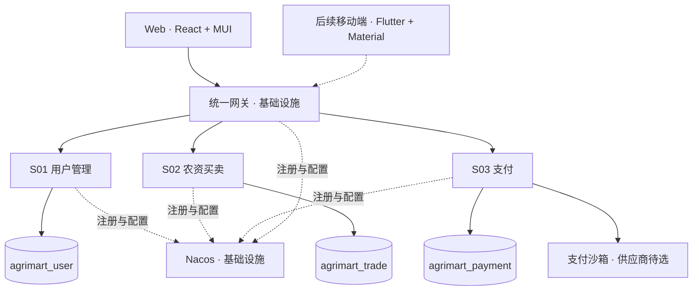
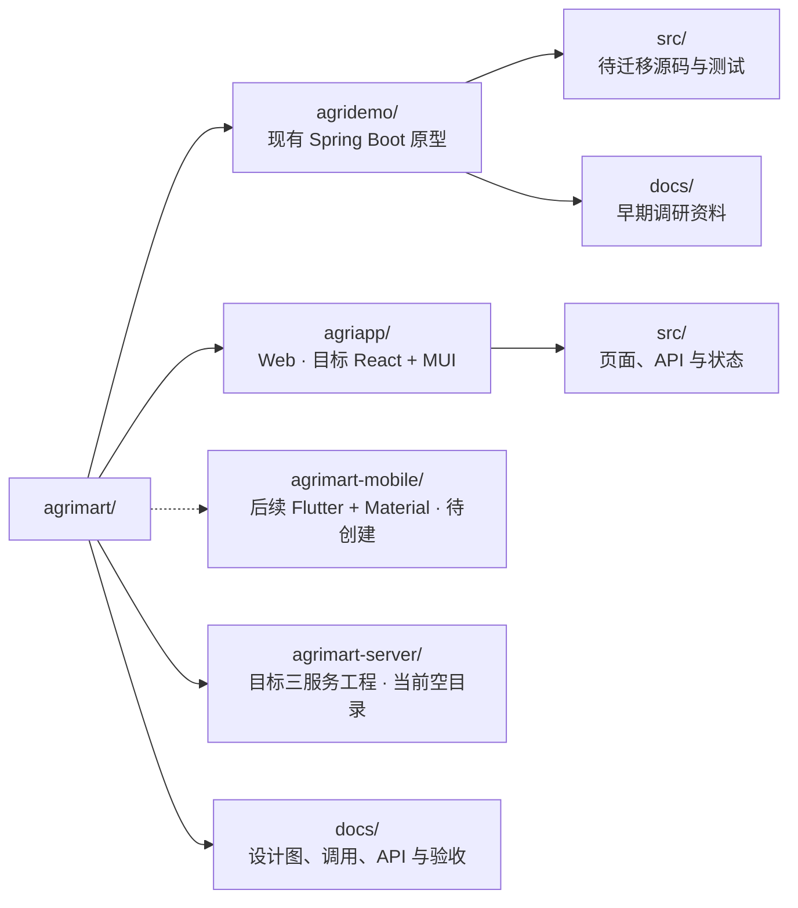

# 农惠达 · AgriMart

农资电商与农机共享平台。开发起步阶段聚焦农资采购闭环，规划用户、农资买卖、支付三个业务微服务，配套统一网关及注册与配置中心。农机共享进入后续阶段。

## 设计文档

[业务边界](docs/00-业务边界与业务规则.md) → [功能架构](docs/01-功能架构图.excalidraw) → [技术架构](docs/02-技术架构图.excalidraw) → [服务清单](docs/03-服务清单.md) → [业务调用](docs/04-业务调用关系.md) → [API](docs/05-API设计.yaml) → [数据库 ER 图](docs/06-数据库设计.excalidraw)。完整入口见 [项目文档索引](docs/00-项目文档索引.md)。

## 目标架构



Web 目标组件库为 MUI（Material UI），后续 Flutter 移动客户端使用对应的 Material 组件；两端统一设计规范并复用业务 API。当前 Ant Design 原型待迁移，移动端工程尚未创建。

三个服务各自独立应用、逻辑数据库与数据库账号，可以共用一个 MySQL 实例；不跨服务建外键、不共享事务。网关和 Nacos 不计入三个业务服务。商品、库存、订单、人工物流、评价及退款审核统一由农资买卖服务负责。

## 项目结构

以下为现有目录；三服务目标脚手架见 [编码规范](docs/08-项目结构与编码规范.md)，尚未创建的模块不能据图视为已经实现。



## 开发起步阶段的业务范围

- 农户注册登录，商家申请入驻并由管理员审核。
- 农资商品搜索、商家商品管理、库存维护及平台禁售。
- 按商家拆成独立订单，分别支付、发货及退款。
- 统一沙箱支付契约，供应商待定；商家手工维护承运方和运单号。
- 未支付取消或超时关闭；发货前由商家审核的全额退款；收货完成后逐订单项评价。

目标 API 共 54 个操作，含 44 个外部操作及 10 个内部调用。当前原型只有 19 个业务接口，尚未完成三服务拆分、可信令牌、网关治理、沙箱与退款接入。文档描述目标设计，不是已实现声明。

## 现有原型启动参考

后端当前使用 JDK 25、Spring Boot 4.1.1 和 MySQL 8.0；前端使用 React、TypeScript、Vite 和 Ant Design，具体版本以各清单与锁文件为准。新微服务工程还需单独验证 Spring Cloud 与 Nacos 的兼容版本。

在 agridemo 目录启动数据库，等待就绪后启动原型：

```bash
cd agridemo
docker compose up -d mysql
./mvnw spring-boot:run
```

另开终端启动前端，开发 API 使用现有代理：

```bash
cd agriapp
npm ci
VITE_API_BASE_URL=/api npm run dev
```

前端默认地址为 http://localhost:5173，原型 API 为 http://localhost:8080/api。原型无预置账号初始化器，需创建虚构账号；现有默认配置不适合直接公开访问或处理真实交易。上述命令不会启动目标三服务及治理设施。

## 贡献与许可证

本项目采用 [MIT License](LICENSE)，允许商业使用、修改和分发，需保留版权与许可声明；第三方依赖及素材遵循各自许可证。开发起步阶段的技术成熟度不构成 MIT 的用途限制。

参与前请阅读 [贡献指南](CONTRIBUTING.md)、[行为准则](CODE_OF_CONDUCT.md) 和 [安全政策](SECURITY.md)。
