# 微服务课程 · 选题报告（第 1 周交付）

## 项目基本信息

| 项目 | 填写 |
|------|------|
| 项目名称 | 农惠达 - 农资电商与农机共享平台 |
| 选题场景 | ☑ 农业场景 |
| 所选子场景 | 子场景 C · 农资电商 + 农机共享 |
| 小组 / 个人 | ☑ 个人 |
| 负责人 | __________ |
| 学号 | __________ |
| 班级 | __________ |
| 任课教师 | __________ |
| 提交日期 | 2026年__月__日 |

---

## 1. 项目名称 & 一句话定位

### 1.1 项目名称
- **中文名**：农惠达 - 农资电商与农机共享平台
- **英文名**：AgriMart - Agricultural Resources E-commerce & Machinery Sharing Platform

### 1.2 一句话定位
**基于微服务架构的农资电商与农机共享平台 —— 为农户提供「正品农资在线采购」和「低成本农机租赁」服务，解决「农资价格高、假货多、农机闲置率高」的三大痛点。**

---

## 2. 行业背景与目标用户

### 2.1 行业现状

中国农业正处于"传统农业 → 数字农业 → 智慧农业"的关键转型期。根据《2026年农机选购：碾米机、粉碎机、电机、铡草机、烘干机、脱粒机、磨浆机及四川电机厂家比较》，2025年中国2327家规模以上农机企业业务收入总额为2661.89亿元。同时，农资市场（化肥、种子、农药）规模巨大，但面临以下突出问题：

**1. 农资质量参差不齐**：假化肥、假种子频发，农户缺乏有效鉴别手段。根据《全国种子鉴定与农药检测行业深度解析》，国家《种子法》《农产品质量安全法》明确要求强化农资质量检测与品种鉴定，打击假冒伪劣。

**2. 农资采购成本高**：农户需要到镇上购买，中间商层层加价，选择少、价格高。

**3. 农机利用率低**：旋耕机、收割机、无人机等农机设备价格昂贵（数万至数十万元），单户购买后闲置率高达70%以上。根据《农机使用与维修》期刊研究，农机设备利用率低、资产沉淀严重是行业普遍痛点。

**4. 农资电商发展迅速但信任度不足**：大丰收农资商城、农一网等平台通过线上渠道减少中间环节，但消费者对农资质量仍存在顾虑，需要完善的评价体系和售后保障。

### 2.2 目标用户

**〔用户 1〕种植大户 / 家庭农场主**
- **典型场景**：每年需要采购大量化肥、农药、种子，同时需要在春耕、秋收时租用农机作业
- **核心痛点**：
  - 担心买到假农资导致减产
  - 批量采购希望获得优惠价格
  - 农机自购成本高但使用频次低

**〔用户 2〕小规模农户**
- **典型场景**：种植面积5-20亩，偶尔需要购买农资和短期租赁农机
- **核心痛点**：
  - 镇上农资店选择少、价格不透明
  - 农机租赁信息不对称，找不到合适的机主
  - 缺乏农资使用指导

**〔用户 3〕农机拥有者 / 农机合作社**
- **典型场景**：拥有旋耕机、收割机、无人机等设备，希望通过共享提高设备利用率
- **核心痛点**：
  - 农忙时订单多但无法统一管理
  - 跨区域作业信息不畅
  - 结算周期长、账期管理困难

---

## 3. 拟解决的问题（核心痛点）

### 用户故事清单

1. **作为种植农户**，我想要**在线浏览和购买正品农资（化肥、种子、农药）**，以便**避免买到假货并节省采购时间和成本**。
   - 优先级：☑ MVP 必选

2. **作为种植农户**，我想要**按地区、时段、价格筛选并预约农机服务**，以便**在需要时快速找到合适的农机进行作业**。
   - 优先级：☑ MVP 必选

3. **作为农机拥有者**，我想要**发布农机服务信息并接收预约订单**，以便**提高农机利用率并增加收入**。
   - 优先级：☑ MVP 必选

4. **作为农户**，我想要**对购买的农资和使用的农机服务进行评价和投诉**，以便**帮助其他农户做出更好的选择并督促商家改进**。
   - 优先级：☑ MVP 必选

5. **作为平台管理员**，我想要**审核商家入驻、商品上架和处理纠纷工单**，以便**保证平台农资质量和服务质量**。
   - 优先级：☑ MVP 必选

6. **作为农户**，我想要**查看农资价格行情走势**，以便**在合适的时机采购农资**。
   - 优先级：□ 扩展（时间允许）

7. **作为农户**，我想要**使用优惠券和参与拼团活动**，以便**降低采购成本**。
   - 优先级：□ 扩展（时间允许）

---

## 4. 竞品分析

### 4.1 选取的竞品
- **竞品 1**：大丰收农资商城（[dfs168.com](https://dfs168.com)）
- **竞品 2**：农一网（[www16899.com](https://www16899.com)）
- **竞品 3**：京东农资频道

### 4.2 维度对比表

| 对比维度 | 竞品1：大丰收 | 竞品2：农一网 | 竞品3：京东农资 | 你的方案 |
|---------|--------------|-------------|---------------|---------|
| **核心用户群体** | 农资零售商、种植大户 | 农资零售商、种植大户 | 种植大户、家庭农场 | 种植农户 + 农机拥有者双边市场 |
| **主要业务场景** | 农资B2B批发 | 农药为主的农资电商 | 综合农资零售 | 农资电商 + 农机共享撮合 |
| **技术架构特点** | 传统电商架构 | 传统电商架构 | 大型分布式电商系统 | 微服务架构（Nacos+Sentinel+Seata） |
| **差异化亮点** | 厂家直供、减少中间环节 | 农药品类齐全、专业性强 | 京东物流、品牌保障 | **农资+农机一站式服务、分布式事务保证订单一致性** |
| **明显不足** | 未涉及农机共享场景 | 品类相对单一 | 农机服务缺失 | 新平台需建立信任体系 |

### 4.3 竞品启发

**竞品名**：大丰收农资商城

**优点**：
- 通过"厂家直供"模式减少中间环节，降低农资价格
- 商品分类清晰（化肥、种子、农药、农机具）
- 提供农技知识库辅助农户选购

**缺点**：
- 未整合农机共享场景，农户仍需单独寻找农机服务
- 评价体系相对简单，缺乏多维度评分
- 缺少实时行情数据展示

**给你的启发**：
1. 必须建立严格的商家审核机制和商品质检流程
2. 农资电商与农机共享结合可形成差异化竞争优势
3. 需要完善的评价体系（多维度评分 + 图片视频证据）
4. 分布式事务确保订单-支付-物流-结算的强一致性

---

## 5. 功能范围（基本需求）

按「用户 / 浏览 / 互动 / 交易 / 后台」5 类列功能，标注 MVP / 扩展：

| 类别 | 功能项 | 优先级 | 验收要点 |
|------|--------|--------|---------|
| **用户** | 注册 / 登录（农户、商家、机主、管理员） | ☑ MVP | JWT鉴权 + RBAC权限控制 |
| **用户** | 个人中心（订单、收藏、地址管理） | ☑ MVP | 用户信息CRUD |
| **浏览** | 农资商品列表 / 详情 / 搜索 / 筛选 | ☑ MVP | 分页 + 关键字 + 品类筛选 |
| **浏览** | 农机列表 / 详情（按地区、时段、价格筛选） | ☑ MVP | LBS地理位置 + 日历可用性 |
| **浏览** | 地图展示（农机位置可视化） | □ 扩展 | 高德/百度地图API |
| **互动** | 商品收藏 / 关注商家 | ☑ MVP | 写库 + 消息通知 |
| **互动** | 商品评价（文字+图片+评分） | ☑ MVP | 评价写库 + 异步通知商家 |
| **互动** | 农机服务评价（双向评价） | ☑ MVP | 农户评价机主 + 机主评价农户 |
| **交易** | 农资下单 → 支付 → 配送 → 确认收货 | ☑ MVP | **Seata分布式事务（订单+库存+支付）** |
| **交易** | 农机预约 → 抢单（机主） → 履约 → 结算 | ☑ MVP | **Seata分布式事务（预约+锁定+结算）** |
| **交易** | 退款 / 退货处理 | ☑ MVP | 逆向物流 + 退款流程 |
| **交易** | 优惠券系统 | □ 扩展 | 满减券、折扣券 |
| **后台** | 商家入驻审核 | ☑ MVP | 审核工作流 |
| **后台** | 商品审核（上架/下架） | ☑ MVP | 商品状态机 |
| **后台** | 数据看板（订单量、GMV、用户增长） | ☑ MVP | ECharts可视化 |
| **后台** | 纠纷工单处理 | ☑ MVP | 工单状态流转 |

**扩展功能（不在5类范围内但想做）**：
- 农资价格行情展示（爬虫采集 + 趋势图）
- 知识库（农资使用指南、常见问题）
- 消息推送（订单状态、农机预约提醒）

---

## 6. 技术选型 & 微服务拆分

### 6.1 技术栈

| 类别 | 选型 | 备选 | 理由（简短） |
|------|------|------|-------------|
| **服务注册 / 配置** | Nacos | Apollo / Consul | 阿里生态整合度高，社区活跃，配置动态刷新成熟 |
| **网关** | Spring Cloud Gateway | Zuul / Kong | 基于WebFlux异步非阻塞，性能优于Zuul，与Spring生态无缝集成 |
| **限流 / 熔断** | Sentinel | Hystrix / Resilience4j | 阿里生态，Dashboard可视化强，规则动态推送，Hystrix已停更 |
| **分布式事务** | Seata（AT模式） | TCC / Saga / 本地消息表 | AT模式零侵入，适合订单-库存-支付场景，开发效率高 |
| **链路追踪** | SkyWalking | Sleuth+Zipkin / Jaeger | 国内社区活跃，APM功能完整，支持多语言 |
| **数据库** | MySQL 8 | PostgreSQL | 开源成熟，事务支持好，Seata AT模式兼容性佳 |
| **缓存** | Redis 7 | — | 高性能KV存储，支持多种数据结构，用于热点数据缓存 |
| **消息队列** | RocketMQ | Kafka / RabbitMQ | 阿里生态，事务消息支持好，适合订单异步处理 |
| **后端语言** | Java 17 + Spring Boot 3.x | Go / Node.js | 企业级成熟度高，微服务组件完善，招聘市场需求大 |
| **前端** | Vue 3 + Element Plus | React + Antd | Vue学习曲线平缓，Element Plus组件丰富，适合快速开发 |
| **搜索引擎** | Elasticsearch | — | 全文检索，支持复杂筛选和地理位置搜索 |
| **文件存储** | MinIO | 本地存储 / OSS | 开源对象存储，S3兼容，部署简单 |

### 6.2 微服务拆分（服务树）

```mermaid
graph TB
    Gateway[Spring Cloud Gateway<br/>统一网关<br/>JWT鉴权/限流/路由]
    
    Gateway --> UserService[User Service<br/>用户服务<br/>注册登录/权限管理]
    Gateway --> ProductService[Product Service<br/>商品服务<br/>农资商品CRUD/搜索]
    Gateway --> MachineryService[Machinery Service<br/>农机服务<br/>农机信息/预约管理]
    Gateway --> OrderService[Order Service<br/>订单服务<br/>农资订单/状态流转]
    Gateway --> PaymentService[Payment Service<br/>支付服务<br/>支付/退款]
    Gateway --> InventoryService[Inventory Service<br/>库存服务<br/>库存扣减/恢复]
    Gateway --> LogisticsService[Logistics Service<br/>物流服务<br/>物流跟踪/配送]
    Gateway --> ReviewService[Review Service<br/>评价服务<br/>评价/评分]
    Gateway --> AdminService[Admin Service<br/>后台管理服务<br/>审核/看板]
    
    OrderService -.Seata分布式事务.-> InventoryService
    OrderService -.Seata分布式事务.-> PaymentService
    OrderService -.Seata分布式事务.-> LogisticsService
    
    MachineryService -.Seata分布式事务.-> PaymentService
    
    UserService --> MySQL1[(MySQL<br/>用户库)]
    ProductService --> MySQL2[(MySQL<br/>商品库)]
    OrderService --> MySQL3[(MySQL<br/>订单库)]
    MachineryService --> MySQL4[(MySQL<br/>农机库)]
    
    ProductService --> ES[Elasticsearch<br/>商品搜索]
    ProductService --> Redis[Redis<br/>热点数据缓存]
    
    OrderService --> RocketMQ[RocketMQ<br/>订单事件]
    
    Gateway --> Nacos[Nacos<br/>服务注册&配置中心]
    Gateway --> Sentinel[Sentinel<br/>流控规则]
    
    OrderService --> Seata[Seata TC<br/>事务协调器]
    
    Gateway --> SkyWalking[SkyWalking<br/>链路追踪]
```

### 6.3 关键场景标注

**〔分布式事务场景 1：农资下单〕**
- **场景描述**：用户下单购买农资 → 扣减库存 → 支付 → 创建物流单
- **涉及服务**：Order Service、Inventory Service、Payment Service、Logistics Service
- **事务模式**：Seata AT模式
- **保证**：四个服务操作必须全部成功或全部回滚

**〔分布式事务场景 2：农机预约与结算〕**
- **场景描述**：农户预约农机 → 锁定时段 → 支付押金 → 作业完成 → 结算尾款
- **涉及服务**：Machinery Service、Payment Service
- **事务模式**：Seata AT模式
- **保证**：预约与支付的原子性

**〔限流 / 熔断场景〕**
- **秒杀接口限流**：春耕季节化肥秒杀活动，限制每用户每分钟下单次数（Sentinel流控规则）
- **下游服务熔断**：当Payment Service故障时，Order Service自动熔断，返回友好提示，避免雪崩

---

## 7. 周里程碑（与课程 13 周对齐）

| 周次 | 课程要求 | 本项目对应产出 | 实际完成 |
|------|----------|---------------|---------|
| 第1周 | 选题报告 + 调研笔记 + 单体版Demo | 本报告 + 调研笔记 + 单体最小闭环（用户注册登录 + 商品列表） | ☑ 是 |
| 第2周 | 需求规格说明 + 原型 | 用户故事细化 / 用例图 / Axure线框图 | □ 否 |
| 第3周 | 服务注册发现 | 各服务注册到Nacos + Dashboard截图 | □ 否 |
| 第4周 | 配置中心 | Nacos配置接入 + 动态刷新演示（修改配置不重启） | □ 否 |
| 第5周 | Sentinel | 订单接口限流规则 + 熔断规则演示 + Dashboard截图 | □ 否 |
| 第6周 | Gateway | 网关统一入口 + JWT拦截 + 跨域配置 | □ 否 |
| 第7周 | Seata | 农资下单分布式事务跑通（订单+库存+支付） | □ 否 |
| 第8周 | SkyWalking | 全链路追踪截图 + 慢接口定位演示 | □ 否 |
| 第9-11周 | 深化 | 农机预约、评价、后台管理全功能跑通 | □ 否 |
| 第12周 | 交付 | 项目文档 + PPT + 演示视频 | □ 否 |

---

## 8. 风险与对策

| 编号 | 风险描述 | 应对措施 | 回滚方案 |
|------|---------|---------|---------|
| R1 | **Seata分布式事务调试困难**：AT模式依赖数据库undolog，异常时难以定位 | 1. 提前搭建Seata Server测试环境 2. 充分阅读官方文档和最佳实践 3. 使用Seata Dashboard监控事务状态 | 降级为本地消息表方案（可靠性略低但实现简单） |
| R2 | **农机预约时段冲突**：并发预约同一农机可能导致超售 | 1. 使用Redis分布式锁控制并发 2. 数据库乐观锁（version字段） 3. Seata事务保证预约与锁定原子性 | 预约改为"提交申请-机主确认"模式，避免自动锁定 |
| R3 | **开发时间不足**：13周内完成全功能压力大 | 1. MVP优先，扩展功能延后 2. 复用开源组件（如支付Mock、短信Mock） 3. 前端使用Element Plus快速搭建 | 砍掉扩展功能（优惠券、行情、知识库），确保核心链路完整 |

---

## 9. 附录

### 9.1 参考文献 / 链接

- [大丰收农资商城官网](https://dfs168.com)
- [农一网 App Store](https://apps.apple.com/us/app/农一网/id1059753900)
- [微服务架构的分布式事务解决方案](https://www.cnblogs.com/hk315523748/p/6003268.html)
- [Spring Cloud Alibaba 深度实战：Nacos + Sentinel + Gateway 整合指南](https://developer.aliyun.com/article/1688578)
- [吃透 Seata 分布式事务：原理拆解 + 生产级落地](https://developer.aliyun.com/article/1717909)
- [全国种子鉴定与农药检测行业深度解析](https://www.cnblogs.com/deepagents/articles/20071113)
- [2026年农机选购：碾米机、粉碎机、电机](https://www.cnblogs.com/deepagents/articles/20167082)

### 9.2 仓库地址
- **单体版 Demo**：`https://github.com/[your-username]/agrimart-monolith`（待创建）
- **调研笔记**：见《05-调研笔记-农资电商平台.md》

### 9.3 评审检查清单

在交付前自查，每项打勾：
- ☑ 5类功能（用户 / 浏览 / 互动 / 交易 / 后台）齐全
- ☑ 至少1个分布式事务场景已标注（农资下单、农机预约）
- ☑ 至少1个限流场景已标注（秒杀接口、服务熔断）
- ☑ 技术栈表格填写完整（每个组件都有理由）
- ☑ 竞品分析 ≥ 2个真实产品（大丰收、农一网）
- ☑ 风险表填写 ≥ 3条
- □ 单体版 Demo 第1周可演示最小闭环（待开发）

---

**完成日期**：2026年__月__日  
**填写人签字**：__________
