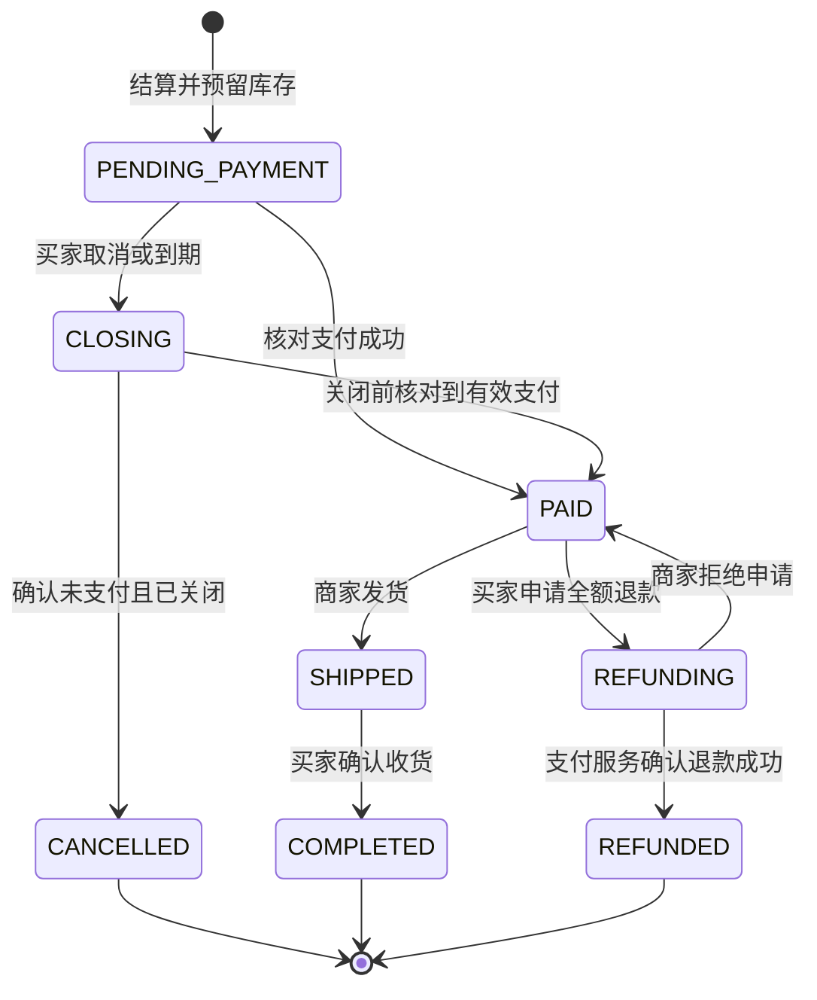

# 农惠达开发起步阶段：业务边界与业务规则

## 1. 讨论结论与设计默认值

**已确认的边界**：本期为农资电商开发起步阶段，农机共享进入下一阶段；接入支付沙箱，平台暂不指定；物流由商家手动维护；跨商家商品拆成独立订单，独立支付、发货与退款。本次交付业务文档与接口契约，不提供业务代码实现。

**已确认的治理规则**：商家申请入驻，管理员审核通过后才获得经营权限；未支付订单允许取消或超时关闭；已支付未发货订单允许申请全额退款，由商家审核；退款审核及执行期间禁止发货。发货后的售后不纳入本期。

**设计默认值**：下单预留库存 30 分钟；每个商品对应一个价格与库存单位，不引入多规格 SKU；运费为零，币种为人民币；买家确认收货即完成订单；每个订单项评价一次；管理员账号由离线初始化流程建立。上述数值和简化策略是本次设计选择，不是外部平台要求。

## 2. 业务价值、范围与排除项

现阶段建设 React + TypeScript 的 Web 客户端，目标组件库改为 MUI（Material UI），现有 Ant Design 原型待迁移。后续新增独立 Flutter 移动客户端，使用 Flutter 的 Material 组件体系。两端统一 Material 设计原则、主题色、字体层级、间距和交互反馈，通过同一网关复用业务与身份接口；移动端不是手机浏览器页面的别名。

采用 Material 体系的目标是提高易用性、可访问性和设计一致性，降低用户与开发者的上手成本。Web 和 Flutter 分别使用本技术栈的组件实现，共享设计规范与业务契约，不直接共用 React 组件代码。移动端工程与页面属于后续建设，本次不扩大当前 Web 交付范围。

本期服务农户采购农资、商家管理商品并履约、管理员维护商家准入与商品经营秩序三个场景。验收以“经过授权的角色能完成交易闭环，且异常不破坏资金记录、库存和订单一致性”为目标；不以页面按钮存在、HTTP 200 或状态枚举存在作为完成依据。

纳入范围：注册与登录、本人资料查询、商家申请审核、商品搜索与详情、商家商品维护、前端购物车、按商家拆单、独立沙箱支付、超时关单、人工发货、确认收货、发货前全额退款审核、商品评价与商家回复，以及必要的幂等、权限、审计和异常恢复。

排除范围：农机发布与预约、真实资金交易、商家分账和提现、平台佣金、发票、优惠券、运费计算、购物车服务端持久化、地址簿、文件上传、支付合单、部分支付、部分退款、退货、换货、拆包发货、物流轨迹接口、自动收货、消息通知及经营数据看板。图像仅引用已有演示资源 URL，不新增素材上传系统。

开发起步阶段即采用三个独立部署的业务微服务：S01 用户服务、S02 农资买卖服务、S03 支付服务。同时规划统一网关和注册与配置中心；它们是基础设施，不增加业务服务数量。三个服务分别管理 agrimart_user、agrimart_trade、agrimart_payment，可共用一个 MySQL 实例，但各用独立账号，不跨库访问、不建立跨服务外键，不共享数据库事务。

### 2.1 三服务责任与通信边界

| 服务 | 核心责任 | 独立逻辑库 | 不负责的事项 |
| --- | --- | --- | --- |
| S01 用户服务 | 注册登录、令牌会话、角色、商家入驻审核、经营资格查询 | agrimart_user | 商品、订单、资金执行 |
| S02 农资买卖服务 | 商品与库存、结算拆单、订单、人工物流、评价、平台禁售、退款申请和商家审核 | agrimart_trade | 签发用户身份、直接调用支付通道或修改支付记录 |
| S03 支付服务 | 沙箱交易、通道验签、支付关闭、退款执行、资金结果核对与通知 | agrimart_payment | 订单履约、退款业务审批、库存更新 |

网关通过明确的路径优先级转发请求，`/orders/{id}/payments` 优先到 S03，不能被 S02 的通用订单路由覆盖。内部 `/internal/**` 不向公网发布。S01 提供令牌校验，业务服务仍负责角色与资源归属；不接受客户端伪造的用户或服务身份头。服务发现与配置中心采用 Nacos 方向，网关采用 Spring Cloud Gateway 方向，版本必须在脚手架阶段按官方兼容矩阵验证后锁定。

每次跨服务调用都使用调用方专用服务凭据、请求关联号和严格超时。S02 提交自己的订单与库存事务；S03 提交自己的支付与退款事务。通过持久化待办、HTTP 重投、事件业务号去重、单调版本和定期查询恢复最终一致性，不宣称三个数据库同时原子提交；本阶段不强制引入消息队列或 Seata。

资金事实由 S03 负责，订单与库存由 S02 负责。S03 不能直接更新订单表，S02 不能直接更新支付表；S02 展示的退款执行结果是有版本的投影，允许短暂滞后，并由 S03 通知及 S02 主动核对收敛。商家入驻审核和角色更新都在 S01 本地事务中完成，首次拆单及库存预留都在 S02 本地事务中完成。

## 3. 角色、经营权限与数据边界（BR01）

游客仅能浏览公开商品和公开评价。所有自助注册账号均为 `ACTIVE/FARMER`，不接受客户端指定 `ADMIN`、`MERCHANT` 或 `MACHINE_OWNER`。农户和商家都可以作为买家购买商品，已有购买记录始终按用户 ID 归属，不会因升级商家角色而丢失；本期不开放自购本人商品。

农户提交入驻申请后仍可正常采购，但没有发布与经营权限。每人同时最多一条 `PENDING` 申请；管理员通过后，将申请改为 `APPROVED` 并把账号角色改为 `MERCHANT`，两者必须同一事务生效。驳回须说明原因，之后可以重新申请。此审核是开发起步阶段平台内部准入，不宣称完成现实经营资质认证。

商家只能维护自己的商品、查看自己的销售订单、履行自己的订单、审核自己的退款及回复自己商品的评价。管理员仅处理入驻审核与商品禁售，不因管理员身份自动获得代支付、代发货、修改库存或查看全部收货资料的权限；不能审核自己的入驻申请。用户账号停用属于既有状态约束，本期不新增账号停用管理流程。

身份由服务端校验的令牌确定，`userId`、`merchantId` 或订单号都不能作为授权凭据。目标认证使用有效期 2 小时的可撤销不透明 Bearer 令牌，退出即吊销；无刷新令牌流程，到期重新登录。读取他人私有资源统一返回 404，缺少角色返回 403，无有效登录返回 401。公开评价只展示脱敏作者名。

## 4. 商品、购物车与结算（BR02、BR03）

商品分类沿用化肥、种子、农药、农具四类。商家创建商品时初始为 `OFF_SALE`，资料完整且价格不低于 0.01 元才可上架。商品仅使用 `ON_SALE/OFF_SALE`，零库存通过库存字段表达；平台禁售另有独立限制，商家不能自行解除。下架不影响已产生订单的履约和历史快照。

公开列表、商家店铺和公开详情只展示有效经营商家的上架且未禁售商品。商家通过管理接口查看自己的下架商品与预留库存。购物车延续前端内存方案，不锁价格或库存；刷新丢失购物车是本期已声明限制。下单时重新核验商品可见性、所属商家与实时库存，并拒绝商家购买自己的商品。

一次结算请求最多 50 行商品，每种数量 1～9999；重复商品行先合并，再校验合并数量。服务端使用当前价格计算金额，以 `BigDecimal` 按元计算，固定两位小数，单笔商家订单不超过 99999999.99 元。客户端不提交成交金额、商家身份或币种；若结算价格变化，应展示返回的订单金额，由买家在支付前确认。

一个结算批次按商家拆成多个订单，每单只属于一个商家，并保存商品名称、单价、图片和收货信息快照。所有拆单及库存预留在一个本地数据库事务中提交；任何商品失效或库存不足时，整个结算失败，不返回部分成功。结算成功之后，各订单独立支付和取消，不保证整个批次一起成交。`checkoutNo` 仅用于查询批次，不承担资金结算。

## 5. 库存、销量与并发（BR04）

目标模型将可用库存 `stock` 与预留库存 `reservedStock` 分开：下单时可用量减少、预留量增加；确认支付时预留量减少、销量增加；未支付关闭时预留量减少、可用量恢复；已支付未发货退款成功时可用量恢复、销量扣回。退款申请或审核通过不提前恢复库存。商家人工调整只作用于可用量，并记录非零增量与原因。

库存预留必须使用带剩余量条件的更新、锁或等效并发控制；预留扣减、状态转换和库存流水要原子提交。重复请求与回调不得重复扣减或恢复。结算按固定商品 ID 顺序操作以降低死锁风险，事务冲突允许有限重试，但不能重新生成另一批订单。单纯添加 `@Transactional` 不构成并发正确性证明。

## 6. 订单状态与履约（BR06、BR07）

下图是目标状态机。`CLOSING` 是取消与超时关闭的中间态，用于处理支付核对；`REFUNDING` 同时覆盖退款审核与通道执行，具体阶段查看退款记录。本期删除旧流程中的独立 `DELIVERED` 步骤，买家确认收货后直接完成。状态码保留技术标识，业务动作使用中文，不代表现有接口已经实现。

商家只可对 `PAID` 订单发货，必须填写承运方与运单号；一个订单整单发货，不支持分批。商家提交发货与买家申请退款必须竞争同一订单状态：只有一个能从 `PAID` 成功转换，另一个收到冲突。买家只能对自己的 `SHIPPED` 订单确认收货，进入 `COMPLETED`；本期无自动收货任务。

订单不得通过通用“设置状态”接口修改。支付成功、发货、收货、退款、关闭分别使用具有前置条件的业务命令。管理员也不拥有绕过状态机的接口。所有状态改变记录操作者、前后状态、原因、时间和关联业务号，避免仅有最终状态而无法追溯。

## 7. 沙箱支付与取消竞态（BR05、BR06、BR12、BR15）

本期默认使用一个沙箱收款账号模拟平台收款，各商家是业务订单的经营主体，不在支付通道开通独立子商户，也不进行分账或提现。验签时的通道商户号与订单中的 `merchantId` 是不同概念，二者都要通过服务端配置和订单关系核对，不能由客户端混用。

每个订单只有一个稳定的支付业务号 `paymentNo`。S03 先创建按订单号唯一的支付记录，再经 T01 向 S02 申请支付授权，绑定业务号并获取金额、归属和到期时间；重复拉起复用同一交易，不延长 30 分钟有效期。供应商、沙箱环境、金额和人民币币种来自服务端配置及订单快照。未配置适配器返回 `503/PAYMENT_PROVIDER_NOT_CONFIGURED`，不能退回前端点击即成功的模拟流程。

浏览器返回页、客户端提交结果和二维码已展示都不能证明付款。只有通过供应商验签的通知或服务端主动查询，并核对商户、环境、支付业务号、订单金额、币种和交易状态后，才可记录支付成功。通知在持久化成功后应答；重复、乱序和旧通知不能使成功状态倒退。供应商退款通知也遵循同样原则。

S02 的内部任务扫描到期订单、投递关闭和退款命令，并核对资金结果投影；S03 的内部任务核对未知支付与退款、执行通道待办并重投资金事实，不能依赖用户持续打开页面。默认每分钟扫描到期订单，因此 30 分钟是停止支付的业务截止时间，完成关单与释放库存可能因核对而延后；正常无通道异常时应在下一次扫描完成。内部任务不提供允许客户端直接改支付结果的 Controller 接口。

买家取消或订单到期时先进入 `CLOSING`，停止拉起支付。若从未发起支付，可立即释放库存；否则必须完成通道查询与关闭。支付创建与关闭必须按订单串行协调，确保没有未完成的创建调用可能在释放库存后又创建可支付交易；创建调用仍在途时，仅查询“交易不存在”不足以释放库存。通道超时或结果未知时保留库存并重试，不能猜测未支付。

关闭过程中发现已经成功且在有效期内的支付时，正常确认 `PAID`，取消不生效，买家可走退款流程；只有确认未支付且关闭后才进入 `CANCELLED`。成功时间超出有效期，或订单已经取消后才确认收到资金时，订单不得复活，应创建 `LATE_PAYMENT_COMPENSATION` 系统全额退款。此类补偿不需要商家审核，也不重复恢复已释放库存或增加销量；买家可在退款列表追踪结果。

支付适配器必须支持创建交易、查询交易、关闭交易、全额退款、退款查询及可信结果验证，并提供可信支付成功时间以判定是否超期；时间无法确认时保留未知状态继续核对。支付接口暂限定返回浏览器可访问的 `checkoutUrl`；不能提供该交互的供应商需要先调整契约。选型后必须补齐签名算法、证书或密钥来源、原始通知字段、应答格式、错误码与重试规则。本文件没有虚构通用供应商通知协议，适配细节未完成前不得宣称支付验收通过。

## 8. 发货前退款（BR08、BR09）

买家仅能为自己的 `PAID` 订单申请整单全额退款，金额由服务端取已确认实付金额，不允许客户端指定。创建 `PENDING_REVIEW` 退款记录的同时，订单原子转为 `REFUNDING` 并冻结发货；每单最多一条活动退款。商家只能审核本人订单，拒绝须说明原因，退款变 `REJECTED`、订单恢复 `PAID`，买家可以重新申请。

同意退款只表示进入执行阶段，不代表资金退回。S02 在本地事务内保存审核结果和 P02 持久化待办；S03 收到命令后经 T03 验证授权，在自己的支付库建立唯一退款执行记录并调用沙箱。S03 确认通道成功后持久化结果和 T04 通知，S02 收到事实后在自己的本地事务内更新退款投影、订单 REFUNDED、库存与销量，副作用只执行一次。任一步超时都通过原业务号重投或查询，不使用跨库事务。

通道明确失败记录为 `FAILED`，结果不确定记录为 `UNKNOWN`；订单继续保持 `REFUNDING`，不能擅自恢复发货或库存。重试必须先查询原退款结果，并使用原 `refundNo`，不能生成第二笔退款。商家可重试已批准的本人订单退款，系统补偿由内部任务重试。未恢复的异常应在验收记录中列为阻塞，不通过数据库直接改状态伪造完成；本期无商家审核超时自动通过规则。

## 9. 评价、平台禁售与通用规则（BR10、BR11、BR13、BR14）

只有订单买家可在 `COMPLETED` 后按 `orderItemId` 评价，服务端从订单项推导商品、订单与用户关系。每个订单项只能评价一次，评分为 1～5，内容最多 2000 字符；商家对自己商品的评价只能回复一次，最多 1000 字符。同一订单多个商品可分别评价，商家不能修改买家评分；均分基于已保存评价集合计算，并对并发写入提供一致性保护。

管理员设置商品禁售时记录原因、强制下架并阻止商家重新上架；解除限制后不自动上架。平台治理不修改已成交快照、不删除订单，也不跳过退款审核或资金验证。单条商品被禁售不影响其他商品，本期不扩展为账号封禁与全店经营处置流程。

契约中标注 `Idempotency-Key` 的写操作必须携带 16～128 位字母、数字、下划线或连字符组成的键。作用域为认证主体、操作与目标资源，保存规范化请求摘要；同键同请求返回原业务结果，同键不同请求返回 409。缓存记录至少保留 7 天；业务号、结算键、订单项评价唯一键及库存流水唯一键不能随缓存过期而消失。重放返回的创建快照可能已过时，应通过查询接口获取最新状态。

接口统一以 `/api` 为基址，JSON 字段使用 camelCase；目标金额使用两位小数字符串，ID 为正整数且不超过 JavaScript 安全整数上限。分页为 `records/total/page/size/totalPages`，页码从 1 开始、默认每页 10 条、最多 100 条，按创建时间与 ID 倒序；时间使用带时区的 ISO 8601，页面按 Asia/Shanghai 展示。没有值的可选字段省略，评分无评价时为 null。

字符串必填项去除首尾空白后不得为空，长度限制在规范化后检查，密码保持原样不裁剪。库存整数运算和金额计算均须检查溢出；人工入库还要为未完成订单可能释放或退款回补的数量保留上限空间。状态相关的付款、发货、完成和退款时间字段须随相应状态提供，不能只写状态不保存交易证据。

同步成功使用 HTTP 200 和 `{code:200,message,data}`；异步命令使用 HTTP 202，响应只表示已接受，应查询最终状态。失败使用真实的 400、401、403、404、409、500 或 503，并返回稳定 `errorCode` 和 `traceId`；错误响应的 `code` 与 HTTP 状态一致。供应商回调按通道协议原样应答，是 Result 包装的例外；不向客户端回传内部异常、密钥或数据库细节。

## 10. Controller 接口分组与现状映射

目标接口共 54 个操作，其中 44 个外部操作、10 个内部操作，共 52 个路径、79 个模型。每个操作标记所属服务、Controller、调用范围和实现状态。外部接口使用网关基址 `/api`；内部接口使用对应服务地址，不暴露到网关。

| 服务 | 外部操作 | 内部操作 | 合计 |
| --- | --- | --- | --- |
| S01 用户服务 | 8 | 2 | 10 |
| S02 农资买卖服务 | 31 | 4 | 35 |
| S03 支付服务 | 5 | 4 | 9 |

`existing-needs-change` 仅表示现有路由存在，目标行为仍须调整；`planned` 表示待新增；`planned-adapter-required` 表示还需补齐供应商协议。现有 19 个单体接口中，14 个保留路径但迁移服务及修改契约，5 个由新接口替代，不能把单体的路由存在理解为微服务已经实现。

| 现有操作（省略 /api） | 去向 | 主要调整 |
| --- | --- | --- |
| GET `/orders/no/{orderNo}` | 保留路径并调整 | S02：按订单号执行同等归属检查 |
| GET `/orders/user/{userId}` | 替代 | 替换为 S02 GET /orders/me，销售订单另列 |
| GET `/orders/{id}` | 保留路径并调整 | S02：仅本人购买或本人商家订单 |
| GET `/products` | 保留路径并调整 | S02：公开商品过滤及有界分页 |
| GET `/products/merchant/{merchantId}` | 保留路径并调整 | S02：仅公开店铺商品，管理列表独立 |
| GET `/products/{id}` | 保留路径并调整 | S02：检查上架、禁售及商家资格 |
| GET `/reviews/product/{productId}` | 保留路径并调整 | S02：公开可见性与作者脱敏 |
| GET `/reviews/user/{userId}` | 替代 | 替换为 S02 GET /reviews/me |
| GET `/users/{id}` | 替代 | 替换为 S01 GET /users/me |
| POST `/orders` | 替代 | 替换为 S02 POST /checkouts，同库拆单预留 |
| POST `/orders/{id}/cancel` | 保留路径并调整 | S02：先 CLOSING，再通知 S03 关闭并确认结果 |
| POST `/products` | 保留路径并调整 | S02：从认证主体获取商家，初始下架 |
| POST `/reviews` | 保留路径并调整 | S02：按本人已完成订单项评价，唯一约束 |
| POST `/reviews/{id}/reply` | 保留路径并调整 | S02：商家归属、JSON 回复、一次回复 |
| POST `/users/login` | 保留路径并调整 | S01：返回可撤销令牌 |
| POST `/users/register` | 保留路径并调整 | S01：只注册农户，不接受角色，注册不自动登录 |
| PUT `/orders/{id}/status` | 替代 | 替换为支付事实、关闭、发货、收货和退款命令 |
| PUT `/products/{id}/status` | 保留路径并调整 | S02：JSON 状态、归属与禁售检查 |
| PUT `/products/{id}/stock` | 保留路径并调整 | S02：JSON 增量和原因，持久化幂等流水 |

用户服务与支付服务不访问农资数据库；农资服务也不读取用户和支付数据库。内部调用必须明确主体、业务号、金额、版本与处理结果；上一步输出作为下一步输入，超时通过持久化待办和查询补偿。

## 11. 数据影响与迁移

保留用户、商品、订单、订单项、评价的核心概念，新增商家申请、令牌会话、结算批次、支付记录、退款记录、幂等记录、库存流水、通道事件与持久化待执行任务。它们是需要保存的业务责任，不强制每项都单独建表；实际迁移必须明确唯一约束、索引、保留期与恢复方式。

订单增加商家、结算批次、到期时间与关键状态时间；商品增加预留库存与平台禁售标记；评价关联订单项并设置唯一约束。支付业务号、供应商交易号、退款业务号、供应商事件号应在相应通道与环境范围内唯一，避免把测试环境事件误当成其他环境交易。外部调用超时不得持有长数据库事务。

这是显式破坏兼容的目标版本：金额由数字变两位小数字符串，图片由逗号字符串变 URL 数组，商品与订单枚举收敛，登录响应、评价入参、库存与状态入参都改变。必须同步更新前端 API、类型、拦截器、页面、种子数据、OpenAPI 与验收清单。旧多商家订单和无可信付款记录的 `PAID` 数据不得直接冒充新订单；开发起步阶段环境优先使用独立新数据库，保留旧库快照供比对。

## 12. 综合评估、实施顺序与验收

现有原型可复用领域概念、部分 DTO、页面与业务规则，但要交付三个独立服务，还必须完成应用拆分、网关路由、注册配置、身份验证、独立数据库及内部契约。优先建立基础拓扑，再打通用户准入、商品、拆单库存、支付回传、发货退款与评价。不得将现有同进程 Repository 调用复制为跨库 Repository 访问。

首次拆单和库存是农资服务本地一致性；用户审核与角色是用户服务本地一致性；支付和退款是跨服务最终一致性。所有超时保留明确未知状态，命令与事件可重放，业务号唯一。服务短暂不可用时，不得伪造支付成功、提前释放库存或越权降级。目标验收应覆盖独立部署、身份授权、库存并发、支付竞态、退款重试及跨服务故障恢复。

## 13. 文档与实现的关系

本文描述将要实现的开发起步阶段业务设计。当前仓库仍有待迁移的单体原型，现有启动命令仅用于原型核对。实际交付必须通过三服务部署、网关隔离、接口、权限、支付与退款故障恢复验收；文档格式校验不等于功能验收。
